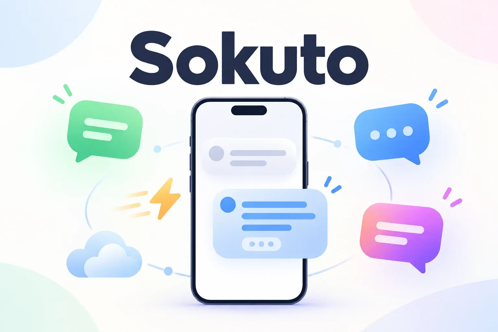
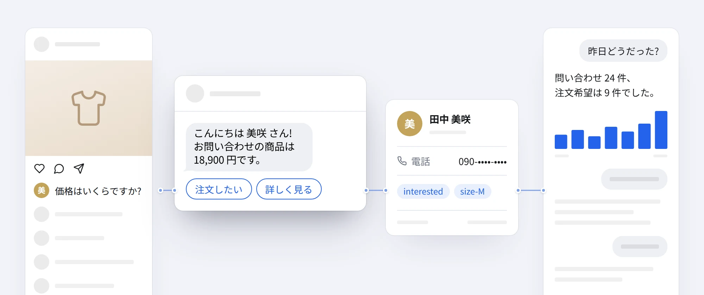

# Sokuto

<p align="center"></p>

Sokuto(即答)= すぐに答える

Sokuto は LINE・Facebook Messenger・Instagram で動くチャットボットを、**あなた自身の無料 Cloudflare アカウント**の上で動かすためのオープンソースソフトウェア (MIT) です。「価格とコメントした人に DM で価格を送る」「友だち追加した人にあいさつしてアンケートを取る」といった自動応答を管理画面から作れます。ChatGPT / Claude / Claude Code から MCP(AI アシスタントが外部のツールを操作するための共通の接続方式)で自動化を作ったりテストしたりすることもできます。商用サービス noflow.pro のオープンソース代替として作られており、日本向けに LINE 対応を加えています。

[English below](#english)

---

## なぜ Sokuto か

- ソフトウェアは MIT ライセンスで、買い切りどころか無料です。Cloudflare の無料プランの範囲で動くように作られているので、月額料金はかかりません。
- サーバーはあなたの Cloudflare アカウント内で動く Worker(Cloudflare が提供する小さなプログラムの実行環境)です。サービス終了や値上げの影響を受けません。
- 連絡先・会話履歴・設定は自分のデータとして、あなたのアカウントの D1(Cloudflare のデータベース)と KV(同じく Cloudflare の設定保存領域)にだけ保存されます。Sokuto の開発者を含め、第三者には送られません。
- 管理画面で MCP トークンを発行すると、ChatGPT / Claude / Claude Code などの AI から操作でき、「こういう自動化を作って」と頼めます。AI はスキーマを読んで自動化を作成し、テストし、公開まで行えます。

## できること

- チャネル: LINE 公式アカウント、Facebook ページ (Messenger とページ投稿へのコメント)、Instagram プロアカウント (DM・コメント・ストーリー)
- トリガー (9 種類): キーワード / 投稿へのコメント (除外キーワード、コメントへの自動いいね) / 初めてのメッセージ / 友だち追加 (LINE) / すべてのメッセージ (フォールバック。同じ人への再起動間隔を設定可) / リンク・QR コード (ref) / ボタン payload / ストーリーでメンション / ストーリーへの返信
- ステップ (8 種類): メッセージ (画像・ボタン付き) / 質問して保存 (メール・電話番号・数値・URL・日付の入力チェック、スキップボタン) / 条件分岐 (フィールド・タグ・時刻・曜日・登録や前回受信からの日数・Instagram のフォロー有無) / アクション (タグ・フィールド・担当者通知・ボット停止・Webhook) / 待機 (10 秒以下は入力中を表示してその場で待機) / ランダム分岐 / 別の自動化へ / コメントに公開返信 (複数パターンからランダムに選択)
- テンプレート (7 種類): あいさつ、コメント「価格」→ DM、コメント → フォロー確認してリンク送信、よくある質問、満足度アンケート、注文受付、ストーリーメンションのお礼
- 受信箱: 全チャネルの会話を一か所で確認し、返信できます。人が返信するとその相手のボットは自動で停止します。「担当者」「オペレーター」などのキーワードでも停止できます。
- 連絡先: タグ、カスタムフィールド (電話番号など)、検索、CSV エクスポート
- 一斉配信: タグで絞り込み、日時を予約して配信 (1 分ごとに最大 30 通ずつ送信)
- レポート: 自動化ごとの起動数・送信数・ボタンクリック・回答数・完了数・エラー、日別メッセージ数
- テスト: 実際には何も送らずに、お客さんの立場で自動化を試せます
- 設定: ボット変数 (営業時間などを一度登録し、どのメッセージでも `{{bot.hours}}` のように使えます)
- MCP サーバー: 21 個のツールで自動化・連絡先・受信箱・配信・レポートを AI から操作 ([docs/mcp.md](docs/mcp.md))

## 5 分でインストール

用意するもの: Cloudflare アカウント (無料)、GitHub または GitLab アカウント (無料)。

1. 下の **Deploy to Cloudflare** ボタンを押します。

   [](https://deploy.workers.cloudflare.com/?url=https://github.com/Ch1nzo/sokuto)

   README に貼るときのコードは次のとおりです。

   ```markdown
   [](https://deploy.workers.cloudflare.com/?url=https://github.com/Ch1nzo/sokuto)
   ```

2. Cloudflare の画面で、GitHub (または GitLab) との接続を求められるので許可します。続いて Worker の名前、D1 データベース、KV の名前を聞かれます。**すべて初期値のままで構いません**。「デプロイ」を押すと、リポジトリがあなたのアカウントにコピーされ、データベースが作られ、ビルドとデプロイが自動で行われます (数分かかります)。
3. 完了したら、表示された URL (`https://<Worker 名>.<あなたのサブドメイン>.workers.dev`) を開き、**管理者パスワード (8 文字以上) を設定**します。
   - 最初にこの画面を開いた人がパスワードを設定できます。デプロイが終わったらすぐに設定してください。
4. 左メニューの **チャネル接続** から LINE と Facebook / Instagram を接続します (片方だけでも使えます)。
   - LINE: [docs/setup-line.md](docs/setup-line.md)
   - Facebook / Instagram: [docs/setup-meta.md](docs/setup-meta.md)
5. **自動化** → **テンプレートから作る** でテンプレートを選び、文面を自分のお店に合わせて直し、**テスト** で動きを確かめてから **公開する** を押します。
6. (任意) **設定** → **AI 連携 (MCP)** でトークンを発行し、Claude / ChatGPT などをつなぎます ([docs/mcp.md](docs/mcp.md))。

> パスワードを忘れたとき: Cloudflare ダッシュボード → ストレージとデータベース → KV → Sokuto の KV を開き、キー `admin:password` を削除すると、次にアクセスしたときに再びパスワード設定画面が出ます。削除したらすぐに新しいパスワードを設定してください。

## 料金と制限

Sokuto 自体に料金はありません。ただし、次の外部サービスには制限があります。数値は執筆時点のものです。最新情報は各社の公式ページで確認してください。

**Cloudflare 無料プラン**

- Workers: 1 日 100,000 リクエストまで。Webhook (受信メッセージ)、管理画面の操作、MCP の呼び出しがそれぞれリクエストとして数えられます。
- D1: 1 日あたり読み取り 500 万行・書き込み 10 万行、保存容量 5 GB まで。受信メッセージ 1 通につき、連絡先・メッセージ履歴・統計などで数行〜10 行程度の書き込みが発生します。
- KV: 1 日あたり読み取り 100,000 回・書き込み 1,000 回まで。
- 上限を超えると、**UTC 0:00 (日本時間 9:00) にリセットされるまで Worker がエラーを返し、ボットは止まります**。その間に届いたメッセージには返信されません。小規模なお店の利用であれば通常は上限に届きませんが、大量の一斉配信や大きなキャンペーンの前には Cloudflare ダッシュボードで使用量を確認してください。必要なら有料の Workers Paid プランに切り替えられます。
- 定期処理 (Cron) は 1 分ごとに動き、待機ステップを再開し、一斉配信を送信します。

**LINE**

- 応答メッセージ (お客さんのメッセージへの返信) は無料で、通数に数えられません。
- プッシュメッセージ (一斉配信、待機ステップのあとの送信、受信箱からの手動返信など) は、LINE 公式アカウントの料金プランの月間通数に数えられます。無料プランは月 200 通です (2026 年時点)。最新情報は LINE 公式の料金ページで確認してください。
- Sokuto はお客さんのメッセージ 1 つに対し、最初の 1 回だけ応答メッセージ (reply) を使います。1 回の応答で 2 つ以上のステップを送る自動化では、2 つ目以降はプッシュメッセージとして送られ、通数に数えられます。

**Meta (Messenger / Instagram)**

- **24 時間ルール**: お客さんの最後のメッセージから 24 時間を過ぎると、通常のメッセージは送れません。Sokuto の一斉配信は 24 時間以内にメッセージをくれた人にだけ送ります (それ以外は「対象外」として数えられます)。24 時間を超える待機ステップのあとのメッセージも送れずにエラーになります。
- コメントへのプライベート返信 (DM) は、1 つのコメントにつき 1 回だけです。

## 仕組み

<p align="center"></p>

```
LINE / Messenger / Instagram
        │  Webhook (署名を検証)
        ▼
Cloudflare Worker (Sokuto)  ── 管理画面 (React SPA, 静的アセット)
   │   │   └── /mcp  ← ChatGPT / Claude (Bearer トークン)
   │   └── Cron (1 分ごと): 待機の再開・一斉配信
   ▼
D1 (連絡先・会話・自動化・統計)   KV (自動生成された鍵・パスワードハッシュ)
```

詳しくは [docs/architecture.md](docs/architecture.md) を見てください。

## 開発

ローカルでの開発、テスト、手動デプロイ、新しいチャネルやステップの追加方法は [docs/development.md](docs/development.md) にあります。

## noflow との違い

Sokuto は noflow.pro を参考にしたオープンソースの代替ですが、同じものではありません。現時点の違いを正直に挙げると、次のとおりです。

- **ホスト型のインストーラーはまだありません**。Deploy to Cloudflare ボタンで自分の Cloudflare にデプロイする形です。
- **キャンバス (ノードをつなぐ図) のエディタはありません**。ステップを上から並べるリスト形式のエディタです。複雑な分岐は AI (MCP) に作ってもらうと楽です。
- **Meta アプリの設定は手動です**。Facebook / Instagram を使うには、自分で Meta 開発者アプリを作り、一般公開する場合はアプリレビューを通す必要があります ([docs/setup-meta.md](docs/setup-meta.md))。ここが一番手間のかかる部分です。
- 一方で、LINE に対応していること、ソースコードとデータがすべて自分の手元にあること、費用がかからないことは Sokuto の利点です。

## ライセンス

MIT License。[LICENSE](LICENSE) を見てください。

---

<a id="english"></a>

## English

Sokuto (即答) means "instant answer".

Sokuto is an open-source (MIT) chatbot for **LINE, Facebook Messenger and Instagram** that runs entirely on **your own free Cloudflare account** (Workers + D1 + KV + Cron). It ships an admin web app and an MCP server so ChatGPT, Claude and Claude Code can build, test and publish automations. It is an open-source alternative to noflow.pro, with LINE support added for the Japanese market.

### Why Sokuto

- **Free, not just buy-once**: MIT-licensed, designed to fit Cloudflare's free plan.
- **Your server**: a Worker in your own Cloudflare account.
- **Your data**: contacts, conversations and settings stay in your D1 database and KV namespace.
- **AI-operable**: generate an MCP token and let an AI assistant create, test and publish flows.

### Features

- 9 triggers (keyword, comment with exclude keywords and auto-like, first message, LINE follow, any message with optional per-contact cooldown, ref link/QR, button payload, story mention, story reply)
- 8 step types (message with image/buttons, question with input validation (email/phone/number/url/date) and skip, condition (fields, tags, hour, weekday, days since signup or last message, Instagram follow status), action, delay (≤10 s waits inline with a typing indicator), random, goto, public comment reply with random variants)
- 7 templates (including a comment → follow check → link gate), a unified inbox with human hand-over, contacts with tags/fields/CSV export, scheduled broadcasts (30 messages per minute), per-flow reports, a dry-run tester and an MCP server with 21 tools.
- Bot variables in Settings (e.g. opening hours), usable in any message as `{{bot.hours}}`.

### Install in 5 minutes

1. Click **Deploy to Cloudflare**: `[](https://deploy.workers.cloudflare.com/?url=https://github.com/Ch1nzo/sokuto)`.
2. Connect GitHub/GitLab when asked and accept the default names for the Worker, D1 database and KV namespace.
3. Open `https://<worker-name>.<your-subdomain>.workers.dev` and set the admin password right away (the first visitor sets it).
4. Connect LINE and/or Facebook/Instagram under **Channels** ([LINE guide](docs/setup-line.md), [Meta guide](docs/setup-meta.md); both in Japanese with English summaries).
5. Create a flow from a template, test it, publish it.
6. Optional: connect Claude/ChatGPT via MCP ([docs/mcp.md](docs/mcp.md)).

Forgot the password? Delete the `admin:password` key in the Worker's KV namespace and set a new one immediately.

### Pricing and limits

- Cloudflare free plan: 100k Worker requests/day, D1 5M rows read / 100k rows written per day and 5 GB, KV 100k reads / 1k writes per day. When a limit is hit the Worker returns errors (the bot stops) until the reset at 00:00 UTC.
- LINE: replies are free; push messages (broadcasts, messages after a delay, manual inbox replies, and the 2nd+ step sent for one incoming message) count against your Official Account plan's monthly quota (free plan: 200/month at the time of writing).
- Meta: the 24-hour rule applies; broadcasts only go to people who messaged you in the last 24 hours, and delays longer than 24 hours will fail on Messenger/Instagram. One private reply per comment.

### Architecture, development, license

See [docs/architecture.md](docs/architecture.md) and [docs/development.md](docs/development.md). MIT license.

### Compared with noflow

No hosted installer yet (you deploy to your own Cloudflare), no canvas editor (list-based editor; let an AI build complex flows), and the Meta app setup and App Review are manual. In exchange: LINE support, full ownership of code and data, and no fees.
